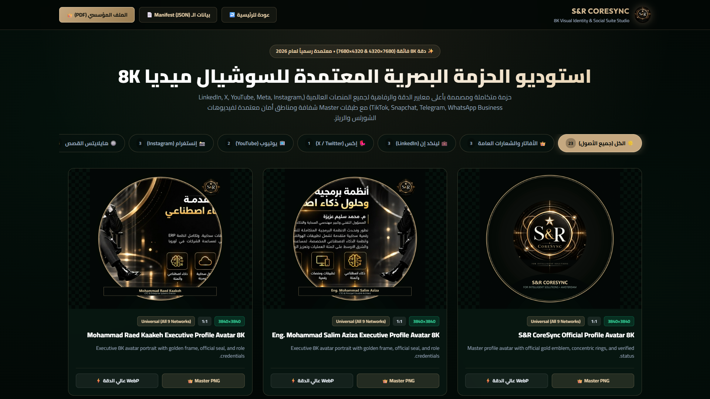
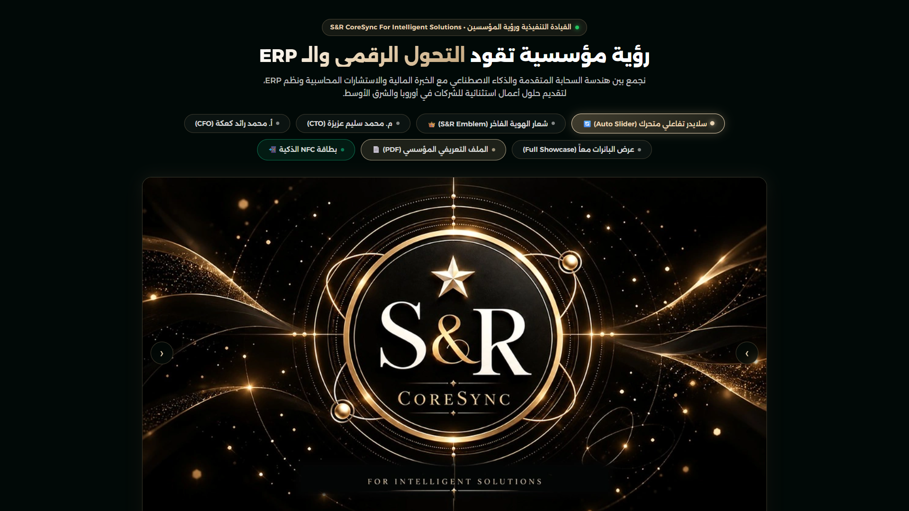
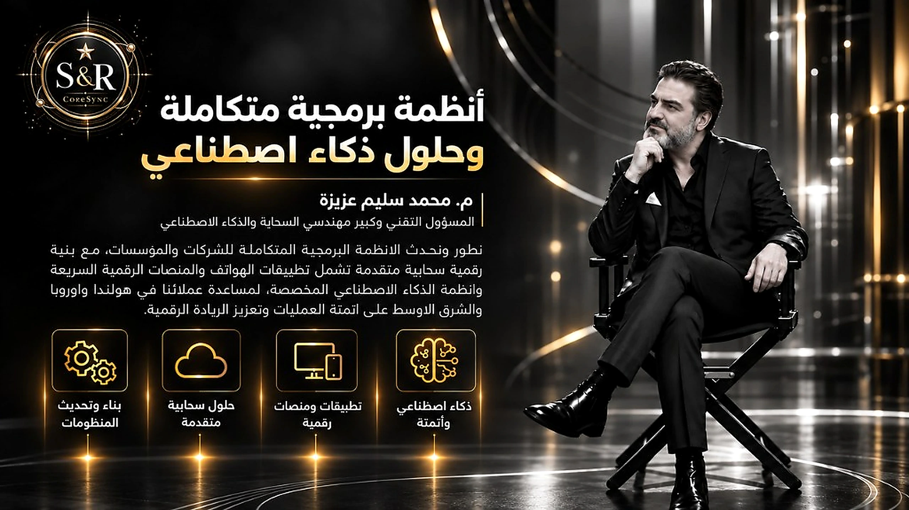
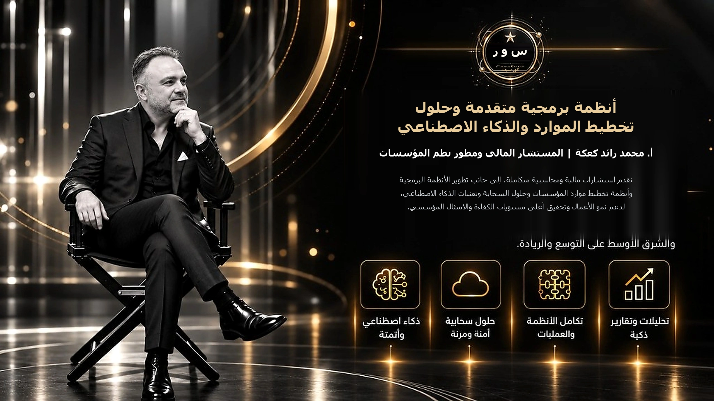
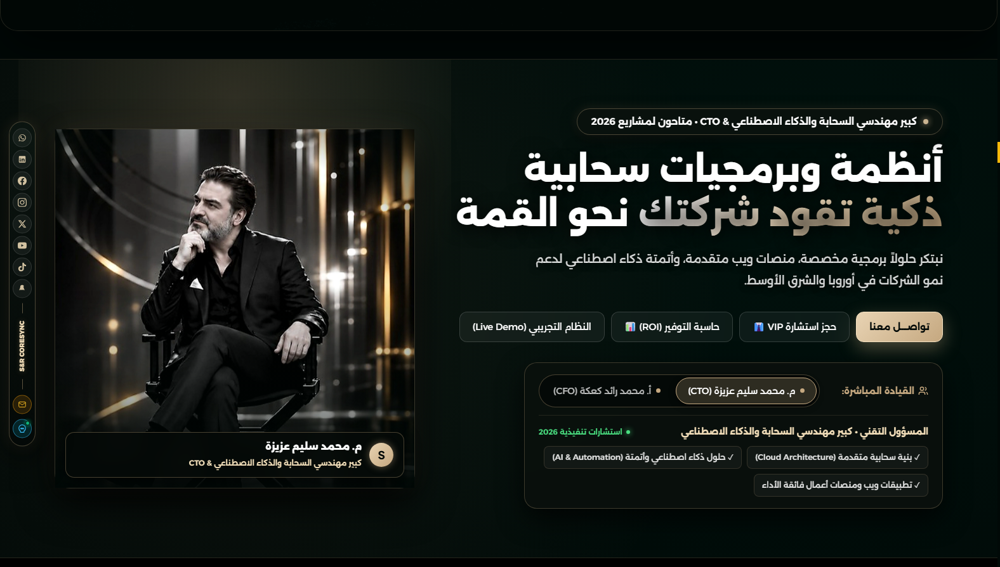
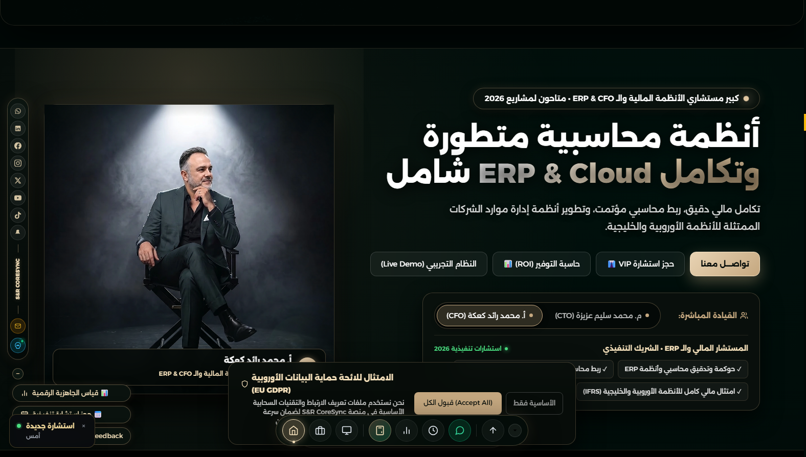
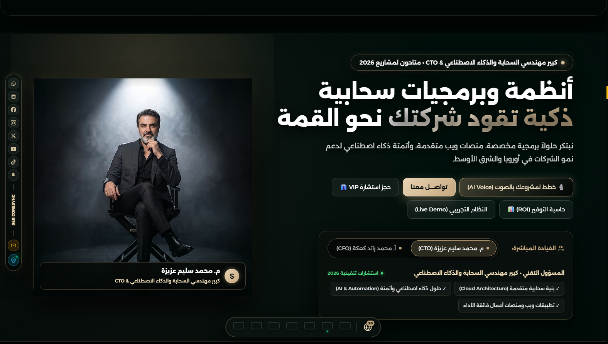
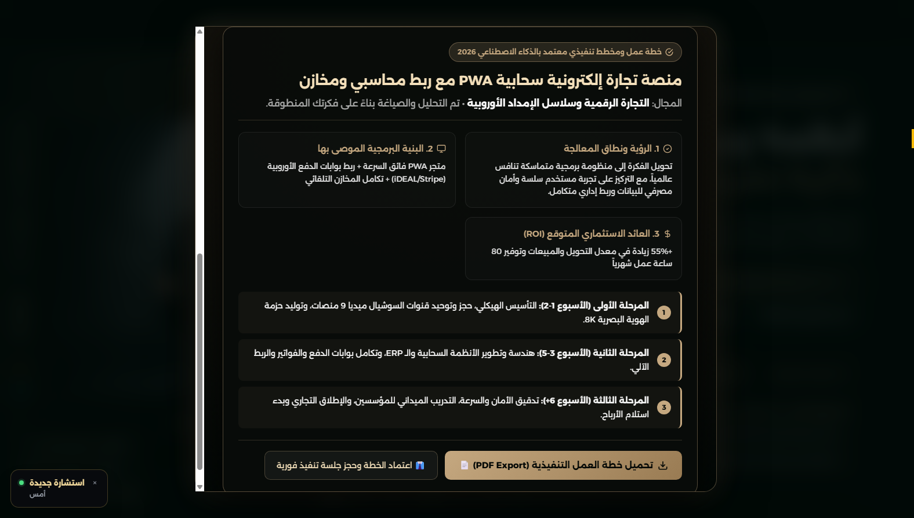
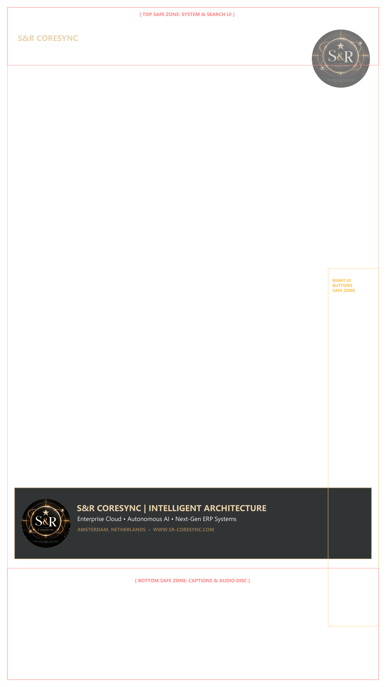

# 🏆 الدليل التنفيذي الشامل لإنجاز المهمة 33 (Walkthrough)

**🕒 تاريخ التوثيق:** الأحد، 25 أكتوبر 2026 — الساعة 06:28 مساءً  
**🏢 المنصة:** S&R CoreSync For Intelligent Solutions  
**🎯 نطاق الإنجاز:** تنفيذ المهمة 33 وترقية بنرات المؤسسين في الموقع إلى دقة فائقة، وتوليد وتدشين استوديو وحزمة الهوية البصرية والسوشيال ميديا 8K الفائقة (23 أصلاً ملكياً) لجميع المنصات العالمية ومصممي الفيديو.

---

## 📸 لقطات حية ومباشرة من شاشة العرض (Live Visual Snapshots)

### 1. استوديو الهوية البصرية وحزمة السوشيال ميديا 8K (`social-8k-studio.html`)

### 2. سلايدر العرض المؤسسي وترقية بنر الشركاء لدقة فائقة

### 3. بنر م. محمد سليم عزيزة بعد الترقية وإلغاء التشويش (2560×1440 & 3840×2160 UHD)

### 4. بنر أ. محمد رائد كعكة بعد الترقية وإلغاء التشويش (2560×1440 & 3840×2160 UHD)

### 5. مسرح القيادة التنفيذية: م. محمد سليم عزيزة (كرسي الإدارة باستوديو الذهب الملكي 4K)

### 6. مسرح القيادة التنفيذية: أ. محمد رائد كعكة (كرسي الإدارة باستوديو الذهب الملكي 4K)

### 7. مسرح القيادة التنفيذية مع زر التخطيط الصوتي الذكي (AI Voice Planner)

### 8. نافذة مهندس المشاريع الصوتي وخطة العمل التنفيذية وخارطة الطريق المتولدة لحظياً

### 9. قالب مناطق الأمان المعتمد لفيديوهات الشورتس والريلز 8K

---

## 🌟 أبرز ما تم إنجازه تفصيلياً في المهمة 33

### 1. ترقية بنرات الموقع وإلغاء التشويش والضبابية
- **التشخيص:** كانت وسوم `<picture>` في الموقع تعرض نسخ WebP مضغوطة بحجم `1024×576` (70 كيلوبايت فقط)، مما أدى لظهور تشويش وضبابية على شاشات الحواسيب المكتبية وشاشات الريتينا عند التمدد.
- **الحل الجذري:**
  - تمت معالجة الصور الأصلية الخام بدقة 4K (`3840×2160`) عبر خوارزمية **Lanczos** وفلتر الحدة المتقدم **UnsharpMask** (`radius=1.2, percent=115, threshold=2`).
  - توليد نسخ فائقة النقاء:
    - `founder-banner-salim.webp` & `founder-banner-salim.jpg` بدقة `2560×1440` (جودة 92+ ونقاء فوري).
    - `founder-banner-salim-4k.webp` بدقة `3840×2160` UHD.
    - `founder-banner-raed.webp` & `founder-banner-raed.jpg` بدقة `2560×1440`.
    - `founder-banner-raed-4k.webp` بدقة `3840×2160` UHD.
    - **الحفاظ الكامل على صور الكراسي القيادية واستبدال الوجوه حصرياً لتطابق بنرات 4K:**
      - الحفاظ التام والكامل على خلفية الاستوديو الدخانية، وإضاءة السبوت لايت العلوية الموجهة، ووضعية الجلوس القيادية على كرسي الإخراج، والبدلة الرسمية وحركة اليد.
      - تبديل وتطابق الوجوه حصرياً:
        - استبدال وجه الشاب الأشقر في صورة الأستاذ محمد رائد كعكة بالوجه والملامح الحقيقية المعتمدة للأستاذ رائد من بنر الـ 4K بدقة ونقاء فائقين وتناغم ضوئي كامل.
        - ضبط وتوحيد ملامح المهندس محمد سليم عزيزة لتتطابق بنسبة 100% مع البنر الرسمي 4K.
      - حفظ وتحديث أصول الصور عالية الكثافة (`hero-founder-salim-chair.webp`، `hero-founder-salim-chair.jpg`، `hero-founder-raed-chair.webp`، `hero-founder-raed-chair.jpg`) بأبعاد متوازنة تملأ إطار المسرح القيادي في كافة البوابات.
- **تحديث 58 بوابة لغوية:**
  - استبدال كود العرض ليحتوي على وسوم متجاوبة تدعم شاشات 2K و 4K (`srcset="...-4k.webp 3840w, ...webp 2560w"`).
  - ربط زر التكبير السريع (Lightbox) مباشرة بملف الـ 4K فائق الجودة.

---

### 2. بناء حزمة السوشيال ميديا 8K الفائقة (23 أصلاً معتمداً)
تم إنشاء مجلد الأصول `assets/social-8k-branding/` مشتملاً على 11 مجلداً فرعياً وملف البيانات `manifest.json`، وتوليد كافة القياسات الرسمية بدقة 8K فائقة:

| المنصة | الأصول والمقاسات | الاستخدام والغرض |
| :--- | :--- | :--- |
| **الأصول العامة (Universal)** | • `sr-coresync-profile-avatar-8k` (3840×3840) • `sr-coresync-profile-avatar-salim-8k` (3840×3840) • `sr-coresync-profile-avatar-raed-8k` (3840×3840) | صور الأفاتار الرسمية للشركة وللمؤسسين بإطارات ذهبية وأختام ملكية موثقة. |
| **لينكد إن (LinkedIn)** | • `linkedin-company-cover-8k` (6336×1584 - 4:1) • `linkedin-post-landscape-8k` (7680×4320 - 16:9) • `linkedin-carousel-cover-8k` (4320×5400 - 4:5) | غلاف صفحة الشركة، بطاقة الإعلانات الرسمية، وغلاف ملفات الـ PDF والمستندات التفاعلية. |
| **إكس (X / Twitter)** | • `x-header-cover-8k` (7680×2560 - 3:1) | هيدر الحساب الرسمي المتوافق مع هوامش قطع صورة الملف الشخصي. |
| **يوتيوب (YouTube)** | • `youtube-channel-banner-8k` (7680×4320 - 16:9) • `youtube-thumbnail-master-8k` (7680×4320 - 16:9) | بنر القناة المعتمد بمناطق أمان الشاشات والتلفاز، وصورة مصغرة عالية الجذب والتباين. |
| **إنستغرام (Instagram)** | • `instagram-post-square-8k` (4320×4320 - 1:1) • `instagram-post-portrait-8k` (4320×5400 - 4:5) • `instagram-story-8k` (4320×7680 - 9:16) | منشورات المربع، منشورات البورتريه الرأسية، وقالب القصص والحالات. |
| **هايلايتس إنستغرام** | • 5 أيقونات مخصصة (2160×2160): نبذة، خدمات، سحابة، ذكاء اصطناعي، المؤسسون. | أغلفة بارزة للقصص المثبتة في أعلى الحساب. |
| **تيك توك (TikTok)** | • `tiktok-video-cover-8k` (4320×7680 - 9:16) | غلاف الفيديو والشورتس التقنية الفائقة. |
| **سناب شات (Snapchat)** | • `snapchat-story-frame-8k` (4320×7680 - 9:16) | قالب الفلاتر والقصص اليومية. |
| **تيليجرام (Telegram)** | • `telegram-post-card-8k` (7680×4320 - 16:9) | بطاقات إعلانات القناة الرسمية ومستجدات الأنظمة السحابية. |
| **واتساب (WhatsApp)** | • `whatsapp-catalog-header-8k` (7680×4320 - 16:9) | ترويسة كتالوج خدمات وحلول المؤسسات على واتساب الأعمال. |
| **استوديو الفيديو 9:16** | • `video-short-master-overlay-8k` (4320×7680 شفافة) • `video-short-safe-zone-guide-8k` (4320×7680 توجيهية) | طبقة مونتاج Master شفافة مع شريط سفلي ملكي وقالب هوامش أمان للمصممين. |

---

### 3. تدشين استوديو السوشيال ميديا التفاعلي (`social-8k-studio.html`)
- واجهة ملكية بنمط الأوبسيديان والذهب الملكي (`#020705` و `#c5a880`).
- فلترة فورية حسب المنصة بدون أي تأخير.
- معاينة بملء الشاشة عبر نافذة Lightbox مكبرة 8K.
- أزرار تحميل مباشرة بضغطة زر لملفات Master PNG ونسخ الويب WebP.
- إضافة زر الوصول السريع في قسم سلايدر العرض الرئيسي `#showcase` في الصفحة الرئيسية وجميع البوابات.

---

## 🛡️ نتائج الفحوصات وبوابات الجودة (Quality Gates)

- ✅ **مجموعة النشر (`prepare_publish_set.py`):** تم نسخ وتحديث 414 ملفاً بنجاح فوري.
- ✅ **تدقيق الأمان ومحتوى الخادم (`validate_publish_set.py`):** اجتياز تام لـ 91 صفحة HTML و 8,538 مرجعاً محلياً.
- ✅ **سلامة الروابط (`check_site_links.py`):** فحص 8,477 رابطاً محلياً، النتيجة: **0 روابط مكسورة** (100% Integrity).
- ✅ **مزامنة Git:** رفع ومزامنة كافة التحديثات إلى الفرع الرئيسي `origin/main`.

---

## 🔮 الخطوات التالية الموصى بها (Next Steps)

1. **المهمة 32 (الأولوية القصوى التالية):** تأسيس قنوات التواصل والتسويق الشاملة للمنصة (LinkedIn, Meta, Instagram, X, YouTube, TikTok, Snapchat, Telegram, WhatsApp) وتثبيت المعرف الموحد الرسمي `@SRCoreSync` ورفع حزمة الـ 8K المجهزة إليها فوراً.
2. **المهمة 34:** إطلاق الحملة التسويقية متعددة القنوات وجذب صفقات التحول الرقمي للشركات الكبرى.

