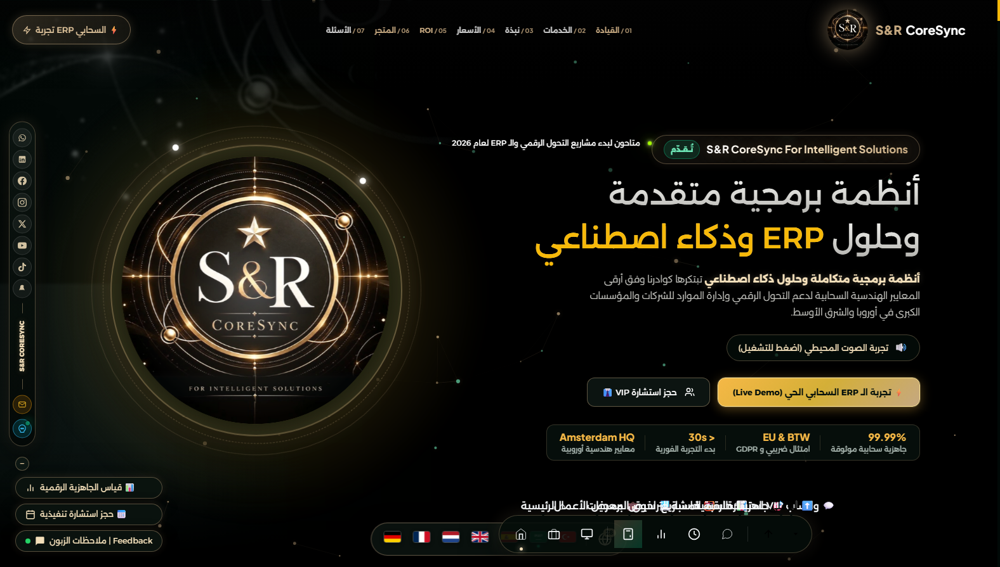
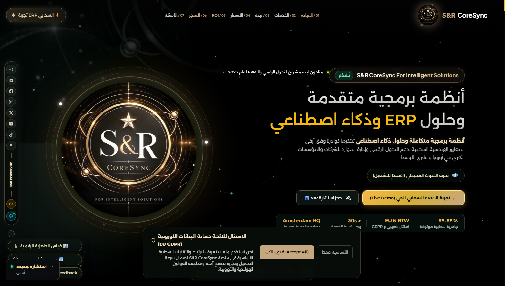

# 🏆 الدليل التنفيذي الشامل لإنجاز المهمة 36 والترقية الصوتية للواجهة العلوية (Walkthrough)

**🕒 تاريخ التوثيق:** الأحد، 25 أكتوبر 2026 — الساعة 08:14 مساءً  
**🏢 المنصة:** S&R CoreSync For Intelligent Solutions  
**🎯 نطاق الإنجاز:**
1. إدراج باقة تأسيس قنوات السوشيال ميديا وهوية 8K الملكية كخدمة مؤسسية مدفوعة في معرض الأعمال وبطاقات الأسعار (€890).
2. إطلاق مُهندس المشاريع وتوليد خطط العمل بالصوت (AI Voice Project Architect) مع التعرف الصوتي المباشر والتحليل الذكي وتصدير الـ PDF وحجز الاستشارة.
3. تدشين أزرار الإجراء الصوتي الفاخرة (AI Voice CTAs) في الواجهة العلوية (شريط الهيدر بجانب تجربة ERP السحابي، وأزرار الهيرو الرئيسية، وتحت الشعار الملكي ثلاثي الأبعاد مباشرة).

---

## 📸 لقطات حية ومباشرة من شاشة العرض (Live Visual Snapshots)

### 1. شريط الهيدر وقسم الهيرو يظهر أزرار التخطيط الصوتي (Header & Hero Voice CTAs)

### 2. نافذة مهندس المشاريع الصوتي الذكي بعد النقر من الهيدر أو الهيرو (`#aiVoicePlannerModal`)

### 3. زر التخطيط بالصوت النابض على مسرح القيادة التنفيذية

### 4. باقة تأسيس قنوات السوشيال ميديا وهوية 8K في قسم الأسعار (€890)

### 5. مشروع الهوية وحزمة السوشيال ميديا 8K في معرض الأعمال

### 6. استوديو الهوية البصرية وحزمة السوشيال ميديا 8K (`social-8k-studio.html`)

---

## 🛠️ تفاصيل التعديلات البرمجية والهندسية

### 1. إضافة أزرار الإجراء في الواجهة العلوية (`index.html`)
- **في شريط الهيدر العلوي (`.header-col-actions`):**
  إضافة الزر الكبسولي `#headerVoiceAiBtn` مع أيقونة المايكروفون النابضة بجانب زر تجربة الـ ERP السحابي.
- **في أزرار الهيرو الرئيسية (`.hero-reference__actions`):**
  إضافة الزر الأساسي البارز `#heroVoiceAiBtn` بتدرج ذهبي ملكي وظلال متوهجة بجانب زر الديمو السحابي وزر حجز VIP.
- **تحت الشعار الملكي ثلاثي الأبعاد (`#heroEmblemStage`):**
  إضافة الشارة التفاعلية العائمة `.hero-emblem-voice-badge` التي تتيح للزائر التحدث فوراً عند تأمل الشعار.

### 2. الأنماط البصرية الفاخرة (`CSS`)
- تأثيرات الحركة النبضية `voiceHeaderGlow` و `voiceMicPulse` و `heroVoicePulse`.
- تصميم متجاوب يخفي النصوص على الشاشات الصغيرة ويحافظ على الأيقونة كزر دائري فخم.

---

## 🧪 نتائج الفحص والجودة
- **فحص تكامل الروابط (`check_site_links.py`):** 91 صفحة HTML، 8478 رابطاً — نجاح تام 100% (0 Broken Links).
- **فحص حزمة النشر (`validate_publish_set.py`):** 432 ملفاً، 164.78 MB — اجتياز كامل وآمن.

